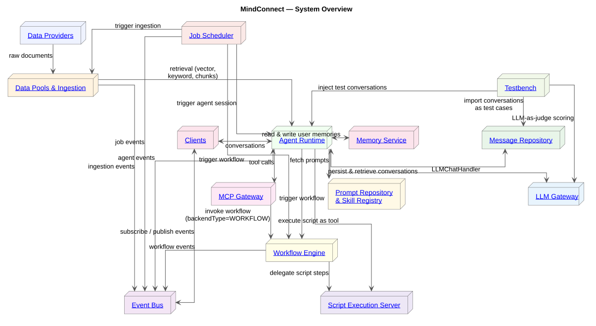
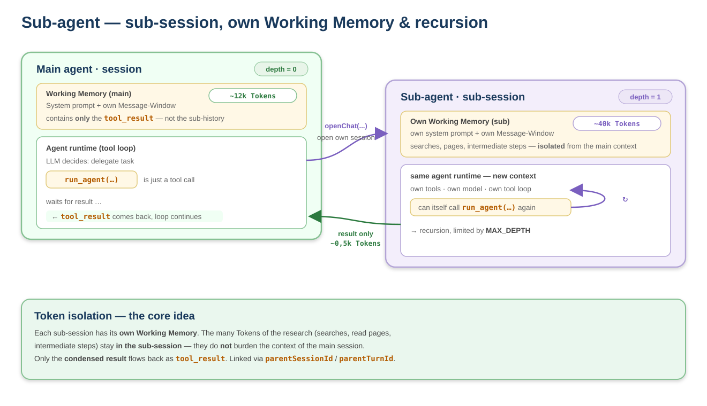
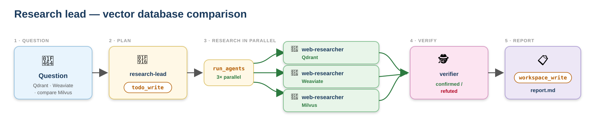
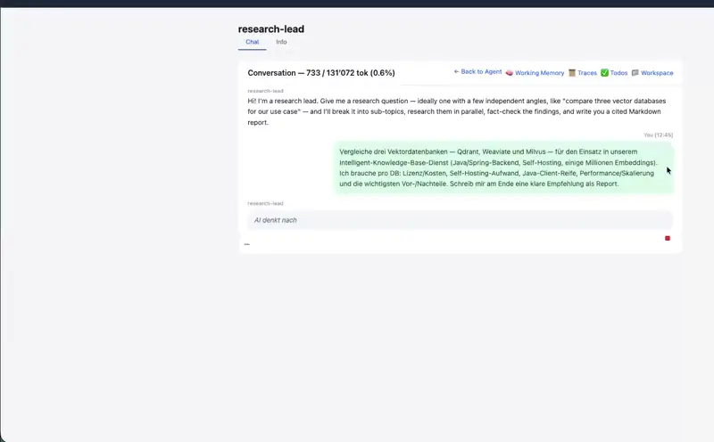
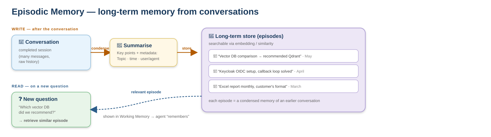

<p align="center">
  <picture>
    <source media="(prefers-color-scheme: dark)" srcset="../.github/assets/logo-dark.svg">
    
  </picture>
</p>

<h1 align="center">agents</h1>

A runtime for **meta-assistants**: an agent that can call other agents.
Each agent is *system prompt + model + tools* with its own session,
memory and message history. A main agent decomposes a task and hands
sub-tasks to specialized sub-agents — for parallelism, specialization,
and a smaller main context.

This area is a self-contained platform — it builds and runs on its own
and does not require `semantic-ui/` or `workflow/`.



## How sub-agents work

The model picks a sub-agent through a tool call
(`run_agent("web-researcher", "Research Qdrant")`). The sub-agent runs in
its **own session** — own prompt, tools and model — does its work, and
returns the result. Sub-agents can call sub-agents recursively.



## Example: the research-lead flow

A `research-lead` agent decomposes a question, spawns `web-researcher`
sub-agents in parallel, has a `verifier` check the findings, and answers
with one cited report.



Here it is running end to end — plan, parallel sub-agents, verify, and
the finished report:



## Modules

### `core/` — libraries (no runnable apps)

| Module | Purpose |
|--------|---------|
| `mc-agent-runtime` | Execution engine: sessions, memory, tool dispatch, sub-agent calls |
| `mc-llm-gateway` | LLM abstraction — streaming chat, model routing |
| `mc-message-repository` | Conversation & message storage |
| `mc-file-store-core` / `mc-file-store` | The runtime's uploads, id-addressed: ports / filesystem backend |
| `mc-agent-tool-spi` | What a tool is: `Tool`, `ToolFactory`, `MultiToolProvider`, the registry, and where file tools read and write |

### `tools/core/` — the built-in tool providers

Each module is a provider against `mc-agent-tool-spi`; a distribution takes the
ones it wants.

| Module | Purpose |
|--------|---------|
| `mc-agent-tools` | Filesystem, workspace and bash — no network, no heavy parsers |
| `mc-agent-tools-code` | Code execution in disposable containers via docker or podman |
| `mc-agent-tools-document` | PDF, Word and text parsing via Tika, PDFBox and POI |
| `mc-agent-tools-web` | HTTP fetch, search and HTML-to-Markdown |
| `mc-agent-tools-web-browser` | Headless Chromium via Playwright for sites the plain fetch cannot see |
| `mc-agent-tools-virtual-env` | Binds the file tools, bash and code execution to a virtual environment server over its REST API |

### `features/` — capabilities beside the runtime core

| Module | Purpose |
|--------|---------|
| `workflow/mc-agent-tools-workflow` | Persisted workflows as tools, one per workflow, and the agent-call and tool-call steps |
| `workflow/mc-agent-workflow` | `WorkflowsFeature`: the workflow store the runtime and the tools share |
| `user-memory/mc-agent-user-memory-core`, `-pg`, `mc-agent-user-memory` | What agents remember about each user, with `UserMemoryFeature` |
| `todo/mc-agent-todo-core`, `-pg`, `mc-agent-todo` | The working todo list of a session, with `TodoFeature` |
| `skills/mc-agent-skills-core`, `-pg`, `mc-agent-skills` | Skills an agent loads at run time, with `SkillsFeature` |
| `file-upload/mc-agent-file-upload-core`, `mc-agent-file-upload` | Files attached to a chat: the `view_attachment` tool, and `FileUploadFeature` with the attach path |
| `approvals/mc-agent-approvals` | The approval gate that parks a flagged tool call until a human answers |

### `tools/vector/` — the knowledge tools

| Module | Purpose |
|--------|---------|
| `mc-vector-store-tools` | The `knowledge` tool group (`vector_upsert`, `vector_search`, …) over the stores in `vectorstore/` |

### `responses-api/` — the protocol a client talks to an agent with

| Module | Purpose |
|--------|---------|
| `mc-agent-protocol` | The vocabulary: `Response`, `Item`, `Conversation`, events and commands — JDK only |
| `mc-agent-protocol-mc-runtime` | The protocol implemented against the Mindconnect runtime: tools, sub-agents and memory run inside the turn |
| `mc-agent-protocol-openai` | The protocol implemented against the real OpenAI Responses and Conversations API |

### `tools/office/` — a person's own things, one port per kind

| Module | Purpose |
|--------|---------|
| `mc-mail-core` | `MailStore`: folders, paging, search, reading, organising, sending — and `MailProvider`, the seam a kind of mailbox plugs into |
| `mc-mail-imap` | IMAP, POP3 and SMTP: the Mailbox card a user fills in, its Test button, and the provider that opens it |
| `mc-agent-tools-mail` | The mail tools (`mail_list`, `mail_read`, `mail_send` …) over every mailbox a user connected, named `provider.key` or `all` |
| `mc-calendar-core` | `CalendarStore`: the calendars, a period of appointments, creating, changing, deleting — and `CalendarProvider` |
| `mc-calendar-caldav` | CalDAV: the card, its Test button, and enough iCalendar to read and write an appointment |
| `mc-agent-tools-calendar` | The calendar tools (`calendar_events`, `calendar_create` …) over every calendar account, named `provider.key` or `all` |

### `tools/mcp/` — Model Context Protocol servers as tools

Registered, not compiled in: an operator adds a server in the admin UI and its
tools join the catalog. Split like the rest of `agents/` — ports in `-core`,
the in-process implementation beside them — so a gateway can later run on a
server of its own without the tool side noticing.

| Module | Purpose |
|--------|---------|
| `mc-mcp-gateway-core` | Ports and types: `McpGateway`, `McpRegistryAdmin`, `McpCatalog`, `McpServerRegistration`, `McpTarget` |
| `mc-mcp-gateway-local` | The in-process gateway — registrations on disk, discovery cache, Docker catalog |
| `mc-mcp-proxy` | Talks to one server over stdio or streamable HTTP, on the official MCP Java SDK |
| `mc-agent-tools-mcp` | The `MultiToolProvider` that turns every registered server's tools into agent tools |

Decisions: [doc/decisions](../doc/decisions/) (tool identity: 0001).

### Registry — import from a GitHub project

A registry is a repository, not a server: an index (`registry.json`) and the
entity files it points at. Add one by its `owner/repo` under **Registry** in the
admin UI, browse what it offers, import an entry — or a package that installs an
agent, its sub-agents, their workflow and the LLM config they share, in order and
each one once.

| Module | Purpose |
|--------|---------|
| `mc-agent-registry-core` | What a registry is: domain, the ports (`RegistryClient`, `RegistrySourceRepository`, `RegistryInstaller`), the import service |
| `mc-agent-registry` | The GitHub client (raw files over HTTPS, optional token), the file-backed store of registries, the LLM-config and agent installers |
| `mc-agent-registry-admin-ui-rest` | The `/registry` screen |

Installers are contributed next to the entity they install — the workflow one is
`mc-agent-registry-workflow`, a module of its own — so an installation without a workflow engine
lists workflows it cannot import and says so, instead of dragging the engine in.

Nothing installs itself: reading a registry is safe, installing one is a decision
a person makes per entry. Format and configuration:
[website/docs/agents/registry.md](../website/docs/agents/registry.md), worked
example: [`doc/registry-example/`](doc/registry-example/).

### `adapter/` — alternative implementations of the core ports

| Module | Purpose |
|--------|---------|
| `postgres/mc-llm-gateway-pg` | `LlmConfigRepository` on Postgres — one JSONB document per config, via `mc-jdbc` |
| `postgres/mc-message-repository-pg` | `ConversationRepository` and `MessageRepository` on Postgres — paged by `created_at` / `seq` |
| `postgres/mc-agent-runtime-pg` | The runtime's seven ports on Postgres — definitions, sessions, LLM traces, todo lists, summaries, working memory |
| `postgres/mc-file-store-pg` | `FileStore` on Postgres — uploads as `bytea` rows |

The default stores are file-based and need no database. A `-pg` module is a
drop-in for the matching `File*` repository: same port, same constructor
shape (a `DataSource` instead of a directory), wrapped by the same decorators.

To run an app on Postgres, set three variables (the `start.sh` scripts read
them from `mc.env`) — the tables are created on start, no migration tool:

```bash
MC_PERSISTENCE=postgres            # default: file
MC_POSTGRES_URL=jdbc:postgresql://localhost:5432/mindconnect
MC_POSTGRES_USER=mindconnect
MC_POSTGRES_PASSWORD=…
```

Embedding without Spring: `AgentRuntimeBuilder.usePostgres(dataSource, dataDir)`.

### `springstarter/` — Spring Boot starters

| Module | Purpose |
|--------|---------|
| `mc-agent-starter-file` | File persistence, the default — every repository, the LLM-config store and the file store under `mindconnect.data.base-dir` |
| `mc-agent-starter-postgres` | `mindconnect.persistence=postgres` — every repository over one pooled `DataSource`, tables created on start |
| `mc-agent-starter-registry` | The registry for a server — the store of configured registries (file or Postgres, seeded from `initial-data/registries/` and `mindconnect.registry.default-source`), the GitHub client, the installers and the `RegistryService` |
| `mc-agent-starter-extension` | The extensions of an installation — the manifests on the classpath, the start-up audit, a namespace's and a brand's decisions (file or Postgres), the `ExtensionService` |
| `mc-agent-starter-workflow` | Workflows for a server — the workflow stores in the namespace of the call (file or Postgres), the admin's runs in the request's namespace and for its user, the agent-call and tool-call steps wired to the runtime |

An app adds both persistence starters; the property picks. `mc-agent-registry` and `mc-extension`
are plain libraries — a Spring Boot server gets their wiring from the two starters.

### `server/` — what runs

Four subdirectories: `app/` the Spring Boot applications, `rest/` and `ui/` the libraries they
embed, `core/` the installation around the runtime (plain Java; Postgres adapters under `adapter/`).

| Module | Purpose |
|--------|---------|
| `app/mc-agent-api-app` | Agent server (REST, streaming via SSE) |
| `app/mc-agent-admin-ui-app` | Admin UI application, port 9090 |
| `rest/mc-agent-api-rest` | The REST API as a library |
| `rest/mc-agent-api-responses-rest` | The OpenAI Responses API shape over the runtime |
| `ui/mc-agent-admin-ui-rest` | The admin UI as an embeddable library |
| `ui/mc-agent-chat-ui-rest` | The chat screens |
| `ui/mc-agent-registry-admin-ui-rest` | The `/registry` screen |
| `ui/mc-mcp-gateway-admin-ui-rest` | The `/mcp-gateway` screen |
| `core/mc-agent-security` | Login and API-token security shared by both apps |
| `core/mc-user-core` / `mc-user` | The users of an installation and their API tokens: domain, ports and services / file and in-memory adapters |
| `core/mc-namespace-core` / `mc-namespace` | The namespaces of an installation and who belongs to them / file and in-memory adapters |
| `core/mc-credentials` | Credential storage for tools and providers |
| `core/mc-agent-registry-core` / `mc-agent-registry` | Import LLM configs, agents, workflows and whole packages from a registry — a GitHub project with an index |
| `core/mc-agent-registry-workflow` | The registry's workflow installer, a module of its own so the registry does not drag in the workflow engine |
| `core/mc-extension-core` / `mc-extension` | What an extension is — manifest, API routes, menu contributions, content per namespace — and its adapters |

### `client/`

| Module | Purpose |
|--------|---------|
| `mc-agent-cli` | Command-line chat client |

## Skills

A skill is know-how written down once — how a report is formatted here, what a
release involves — and loaded when it is needed. Only name and description sit
in the system prompt, a line each; the instructions arrive when the model calls
the `skill` tool for that name. Ten skills cost ten lines until one is used.

They come from three places, read fresh every round: the ones this installation
stores (admin UI, `/api/skills`), a user's own `SKILL.md` files, and a project's
in `.mindconnect/skills/` under the session's working directory — the more
specific source winning by name. An agent switches them on and may name the
ones it gets; naming none leaves it every skill there is.

```markdown
---
name: weekly-report
description: Use when writing the weekly status report for a customer
tools: file_read, vector_search
---
1. Read last week's report under `reports/`.
2. Start from `template.md` in this skill's directory.
```

## Memory

Within a chat, the agent's memory strategy decides what of the conversation
the model sees: the full history, a window, or summaries of older turns
(`memoryConfig` on the agent).

Across chats, an agent remembers the user through **user memory**: small
entries per user and namespace — who they are, how they want things done,
ongoing projects, where to find things. An agent that has the `memory_write`
tool keeps it current itself; one with only `memory_read` reads it. The
names and one-line descriptions of the entries stand in the system prompt
of every round, the content is read on demand. `default-chat` has all three
tools. Entries live in `mc_user_memory` (Postgres) or as Markdown files
under `<data>/<namespace>/memory/<user>/` (file persistence).

An agent can also keep a memory of its own about each user — a secretary's
travel preferences, say — that no other agent sees: set `scope` to `agent` on
its memory tools' bindings (`both` gives it the shared memory as well, and
the model says with each write which one). Users see and delete their
entries on the profile's **Memory** tab and through `/api/memories`; admins
see everybody's in the namespace under **Data → Memory**, and what one agent
keeps about its users on the **Memory** tab of its page.

Episodic memory — condensed past chats found by similarity — is not built
yet.



## Build & run

```bash
# Build the agents sub-tree
mvn -f agents/pom.xml clean install -DskipTests

# Start the agent server
mvn -f agents/server/app/mc-agent-api-app/pom.xml spring-boot:run

# Start the CLI (connects to a running agent server)
mvn -f agents/client/mc-agent-cli/pom.xml spring-boot:run
```

More diagrams live in [`doc/`](doc/).
